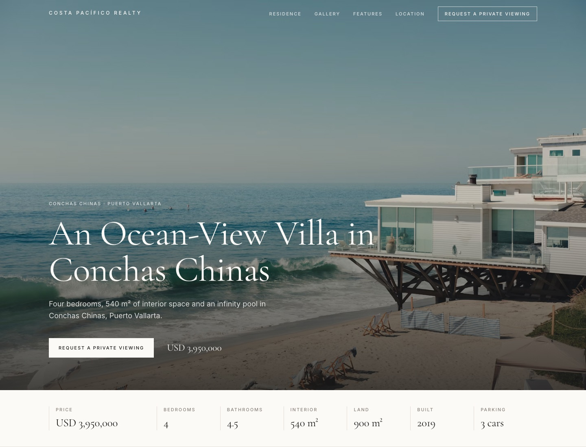
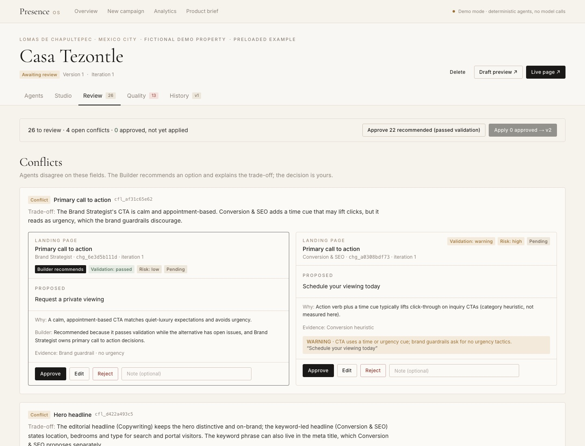
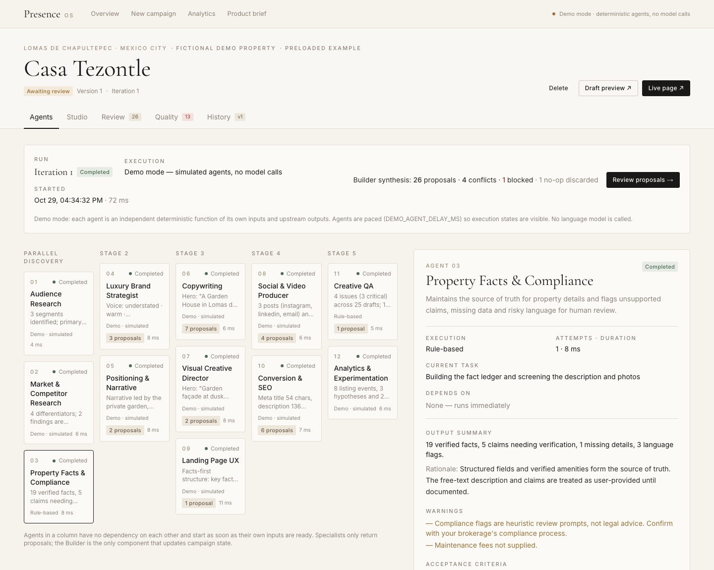
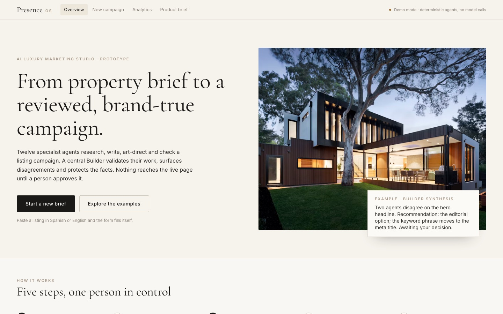
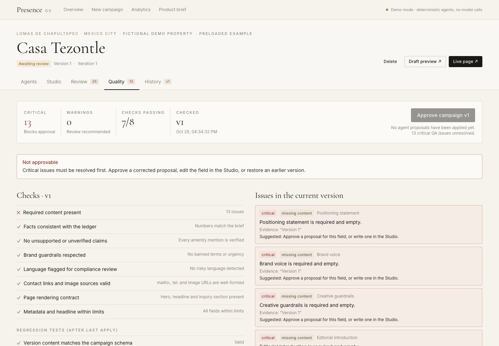

# PresenceOS — AI Luxury Marketing Studio

**Twelve AI agents draft a luxury real-estate campaign. A person approves every change. Facts are protected by design.**

Next.js 16 · TypeScript · Tailwind CSS · Zod · Claude API (optional) · 36 tests · Product case study by **Karyme Ortega**



PresenceOS turns a luxury property brief into a coordinated, reviewed marketing campaign: an editorial
property landing page, listing copy and headline alternatives, social posts, a reel script, brand
direction, QA and analytics. Twelve specialist agents do the work. A central **Builder** orchestrates
them, validates their outputs, surfaces disagreements and protects facts. **A human approves every
change** before it reaches the live page.

> Independent product prototype. Not affiliated with any brokerage or real-estate platform.
> All example properties are fictional; photos are stock imagery.

### Why it is different
- **Disagreements are surfaced, not hidden.** When the copywriter and the SEO agent want different headlines, the Builder shows the trade-off and recommends one, and you decide.
- **Facts can't be invented.** Every proposal is checked against the verified fact sheet. An unverified "forest view" or "beach access" is blocked, and QA proposes a corrected version.
- **Nothing goes live without approval.** Approved changes create immutable versions with a full changelog and one-click restore.
- **Iterations are targeted.** "Make the copy more concise" reruns 7 of 12 agents and reuses the rest.

| Review queue: conflicts with trade-offs | Agent control center |
|---|---|
|  |  |
| **Overview** | **Quality gate** |
|  |  |

## Run it

Requires Node.js ≥ 22.12.

```bash
npm install
npm run dev          # http://localhost:3000
```

Then open <http://localhost:3000>. A new workspace is preloaded with **five fictional example campaigns**
(Mexico City, Valle de Bravo, Puerto Vallarta, Acapulco, Cancún). Their agents really ran on first load;
for four of them the Builder's validation-passed recommendations were pre-applied and are labelled
*seeded (not a human)* in the changelog. Casa Tezontle (Mexico City) is left for you to review.
Example and seed activity is excluded from the analytics aggregates. Campaigns can be deleted from the
Overview or the campaign header; deleted examples can be restored from the Overview.

To start your own: **New campaign → Paste a listing** (Spanish or English). A rule-based parser
(`src/lib/intake/parse.ts`, no model call) fills price, areas, bedrooms, bathrooms (half baths count 0.5),
parking, location, property type and amenities (translated to English), adds an illustrative stock photo
set if none are supplied, and lists what to double-check.

| Command | What it does |
|---|---|
| `npm run dev` | Development server on port 3000 |
| `npm run build && npm start` | Production build and server |
| `npm test` | Vitest suite (workflow, orchestration, fact checks, page rendering) |
| `npm run typecheck` / `npm run lint` | TypeScript and ESLint |
| `npm run check` | All three |

### Environment variables (`.env.local`, see `.env.example`)

| Variable | Default | Purpose |
|---|---|---|
| `ANTHROPIC_API_KEY` | — | Enables **model mode**: the 10 LLM-backed specialists call Claude server-side. Never exposed to the browser. |
| `PRESENCE_MODE` | auto | `demo` forces deterministic mode; `model` requires a key. |
| `PRESENCE_MODEL` | `claude-opus-5-5` | Model used in model mode. |
| `DEMO_AGENT_DELAY_MS` | `700` | Per-agent pacing in demo mode so execution states are visible. `0` disables it. |
| `PRESENCE_DATA_DIR` | `./.data` | Local JSON store and uploaded photos. Delete it to reset. |
| `UPSTASH_REDIS_REST_URL` / `UPSTASH_REDIS_REST_TOKEN` | — | Use Redis instead of the local file (required on Vercel). Vercel's Upstash integration sets `KV_REST_API_URL` / `KV_REST_API_TOKEN`, which also work. |
| `PRESENCE_REDIS_PREFIX` | `presenceos` | Key prefix, to share one Redis database between deployments. |

## Deploy to Vercel

Serverless functions have no persistent disk, so the hosted version stores data in Redis (Upstash, free tier).

1. Push this repository to GitHub.
2. In Vercel: **Add New → Project → Import** the repository. Framework preset: Next.js (defaults are fine). Deploy.
3. In the project: **Storage → Create Database → Upstash for Redis** (free plan, region close to your
   functions, e.g. US East / `iad1`) → connect it to the project. This adds `KV_REST_API_URL` and `KV_REST_API_TOKEN`.
4. **Deployments → Redeploy** so the new variables are picked up.
5. Open the URL. The first visit runs the agents for the five examples (a few seconds) and stores them in Redis.

Optional: add `ANTHROPIC_API_KEY` under **Settings → Environment Variables** to enable model mode.
On the hosted demo, photo upload is disabled (paste image URLs instead). Agent runs continue after the
HTTP response via Next.js `after()`; routes that start runs allow up to 300 s.

## The workflow

1. **Intake** — structured brief that separates *verified* facts and amenities from *claims to verify*
   and free-text description; flags recommended-but-missing details; photo URLs or uploads.
2. **Parallel discovery** — the Builder runs the specialists as a dependency graph; independent agents
   run concurrently.
3. **Synthesis** — each output is schema-validated and checked against the agent's acceptance criteria
   (malformed output is rejected and retried). Outputs become **proposals**; each proposal is validated
   against the facts and brand guardrails. Disagreements open **conflicts** with a trade-off and a
   recommendation — never an automatic choice.
4. **Live preview** — the live page shows only approved content; a draft preview overlays pending proposals.
5. **Human approval** — approve, edit (re-validated) or reject each change. Blocked proposals cannot be
   approved until edited. Bulk approval covers only validation-passed recommendations.
6. **Apply** — approved changes (and nothing else) create a new immutable version.
7. **QA** — fact, claim, brand, compliance-language, link and rendering checks plus regression tests run
   after every apply. Critical issues block campaign approval.
8. **Changelog** — timestamp, version, field, proposing agent, old/new value, rationale, approval type.
9. **Next iteration** — feedback is interpreted; only the targeted agents and their dependents rerun
   (facts and QA always), reusing other agents' last validated outputs, the approved version, earlier
   feedback and rejected proposals.

Versions can be compared field-by-field and restored (restore creates a new version; nothing is deleted).

## Architecture

```
Browser (Next.js client pages)          Server (route handlers, Node)
 Overview · Intake · Agents ·  ──JSON──▶ lib/server/campaigns.ts  ← the only module that mutates state
 Studio · Review · Quality ·              │
 History · Analytics                      ├─ lib/builder/orchestrator.ts   DAG scheduler, validation, retry
                                          │     └─ lib/agents/specialists/*  12 agents (schemas, criteria,
 /p/[id]  public property page  ◀── SSR ──┤        demo generator, model instructions)
                                          ├─ lib/builder/validation.ts + factcheck.ts   proposal gate
                                          ├─ lib/builder/conflicts.ts      conflict detection & policy
                                          ├─ lib/builder/apply.ts          apply / restore → versions
                                          ├─ lib/qa/checks.ts              QA + regression
                                          ├─ lib/analytics/{events,metrics}.ts
                                          └─ lib/server/store.ts           JSON file, serialised writes
```

Key rules the code enforces:

- **Specialists never write state.** They return typed outputs; the Builder converts them to proposals.
- **Only approved proposals are applied**, and they are re-validated at apply time.
- **The fact ledger (Agent 03) and Creative QA (Agent 11) are rule-based in every mode**, so the source
  of truth and the quality gate cannot hallucinate.
- **Version 1 is a facts-only baseline** — no generated copy reaches the live page without approval.

### Agents

| # | Agent | Depends on | Kind |
|---|---|---|---|
| 01 | Audience Research | — | LLM / demo |
| 02 | Market & Competitor Research | — | LLM / demo · no research source connected, findings labelled assumptions |
| 03 | Property Facts & Compliance | — | rule-based |
| 04 | Luxury Brand Strategist | 01, 02 | LLM / demo |
| 05 | Positioning & Narrative | 01, 02, 03 | LLM / demo |
| 06 | Copywriting | 03, 04, 05 | LLM / demo |
| 07 | Visual Creative Director | 03, 04, 05 | LLM / demo · recommends only; no image generation |
| 08 | Social & Video Producer | 06, 07, 04 | LLM / demo |
| 09 | Landing Page UX | 01, 05 | LLM / demo |
| 10 | Conversion & SEO | 06, 09, 04 | LLM / demo |
| 11 | Creative QA | 03–10 | rule-based · proposes corrections |
| 12 | Analytics & Experimentation | 06, 09, 10 | LLM / demo · proposed metrics only |

## Real vs. simulated

| Capability | Status |
|---|---|
| Orchestration, validation, retries, conflicts, approvals, versions, QA, regression, analytics | **Real** — implemented and tested |
| Demo-mode agent outputs | **Simulated** — deterministic functions of each agent's inputs; labelled "Demo · simulated" in the UI |
| Model mode (`ANTHROPIC_API_KEY`) | Implemented with `@anthropic-ai/sdk` structured outputs (`messages.parse` + Zod), refusal handling and server-side fallback. **Not exercised here — no key was available.** |
| Market research | **Not connected** — Agent 02 labels all comparative findings as assumptions |
| Image generation / editing | **Not implemented** — Agent 07 selects and sequences supplied photos |
| Inquiry form on the public page | **Demo only** — nothing is sent; the page says so |
| Analytics | **Measured locally** from instrumented events; no synthetic data. `forwardEvent()` in `lib/analytics/events.ts` is the integration point for PostHog/Amplitude etc. (none connected) |

## Known limitations

- Demo agents demonstrate the workflow, not creative quality; output varies only with brief, feedback and iteration.
- Fact and compliance checks are English-language heuristics — review prompts, not legal advice.
- Photos are judged by caption only (no computer vision).
- The listing parser is heuristic: it handles common Spanish/English listing formats; always review the filled fields.
  Spanish listings are converted to an English campaign in demo mode (amenities via a small glossary).
- No authentication: anyone with the URL can create, approve and delete campaigns. Local file storage is
  single-process; the Redis backend uses per-campaign locks but is still a demo, not a production datastore.
- A run in progress lives in the server process; if the server restarts mid-run, that run is marked interrupted on next load and must be re-requested.

See [docs/PRODUCT_BRIEF.md](docs/PRODUCT_BRIEF.md) for the product case study and roadmap (also in-app at `/product`).
